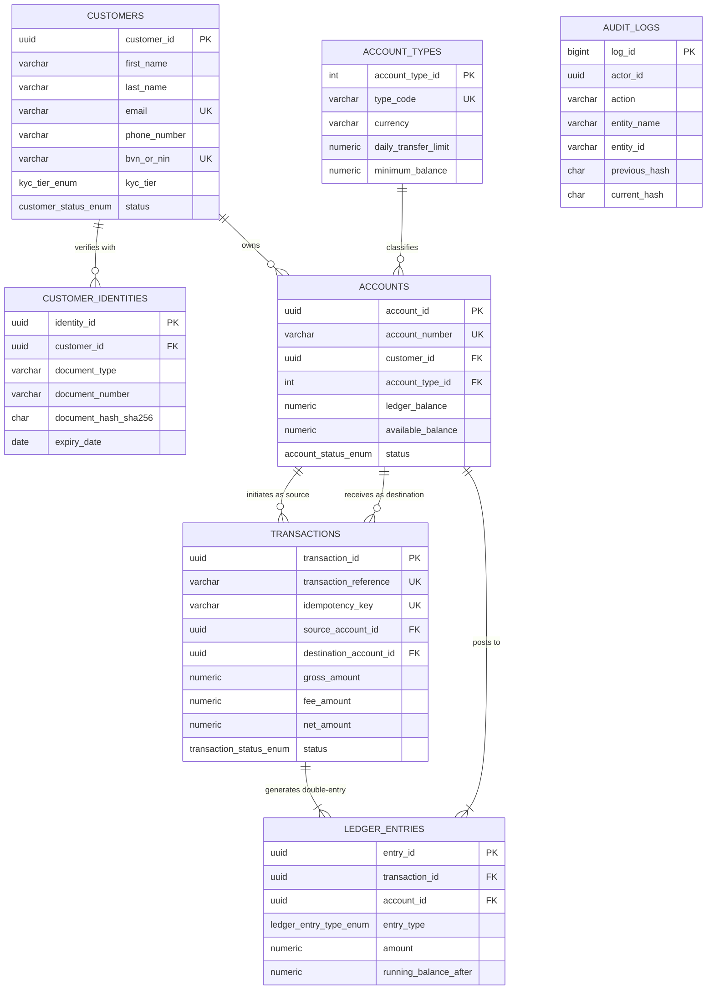

# Entity-Relationship Architecture Description
**Course:** MIT 8103 Advanced Database Systems  
**System:** ApexPay Global Bank / Fintech Platform  
**Student Name:** Ifenna Victor Okany  
**Student ID:** 301923302  

---

## 1. High-Level Entity Catalog

| Entity | Schema | Primary Key | Description |
| :--- | :--- | :--- | :--- |
| **`customers`** | `core_banking` | `customer_id` (UUID) | Individual or business customer profile with KYC status. |
| **`customer_identities`** | `core_banking` | `identity_id` (UUID) | Official KYC verification documents (Passports, National ID). |
| **`account_types`** | `core_banking` | `account_type_id` (INT) | Product catalog defining transaction limits and interest rates. |
| **`accounts`** | `core_banking` | `account_id` (UUID) | Operating financial accounts storing cached balances. |
| **`transactions`** | `core_banking` | `transaction_id` (UUID) | Parent transaction recording payment intent and status. |
| **`ledger_entries`** | `core_banking` | `entry_id` (UUID) | Immutable double-entry bookkeeping ledger (Debits & Credits). |
| **`audit_logs`** | `audit_system` | `log_id` (BIGINT) | SHA-256 cryptographically chained forensic activity trail. |

---

## 2. Mermaid Structural ER Diagram

GitHub automatically renders this diagram visually:

---

## 3. Structural Relationships & Referential Integrity Rules

1. **`customers` to `customer_identities` (1 to 0..N):**
   - **Relationship:** One customer can submit multiple identity verification documents over time.
   - **Referential Action:** `ON DELETE RESTRICT`. A customer record cannot be deleted if active KYC document proofs exist.

2. **`customers` to `accounts` (1 to 1..N):**
   - **Relationship:** A customer owns one or more accounts (e.g. Savings, Current, and USD Domiciliary Wallet).
   - **Referential Action:** `ON DELETE RESTRICT`. Accounts holding balances or financial records cannot be accidentally deleted or orphaned.

3. **`account_types` to `accounts` (1 to 0..N):**
   - **Relationship:** Product types define the operational limits (daily withdrawal and transfer caps) for multiple accounts.

4. **`accounts` to `transactions` (1 to 0..N):**
   - **Relationship:** An account can act as the source or destination across numerous financial transactions.

5. **`transactions` to `ledger_entries` (1 to 2..N):**
   - **Relationship:** Every completed transaction must create at least two balanced ledger entries (one Debit and one Credit) to satisfy the fundamental rule of double-entry accounting.
